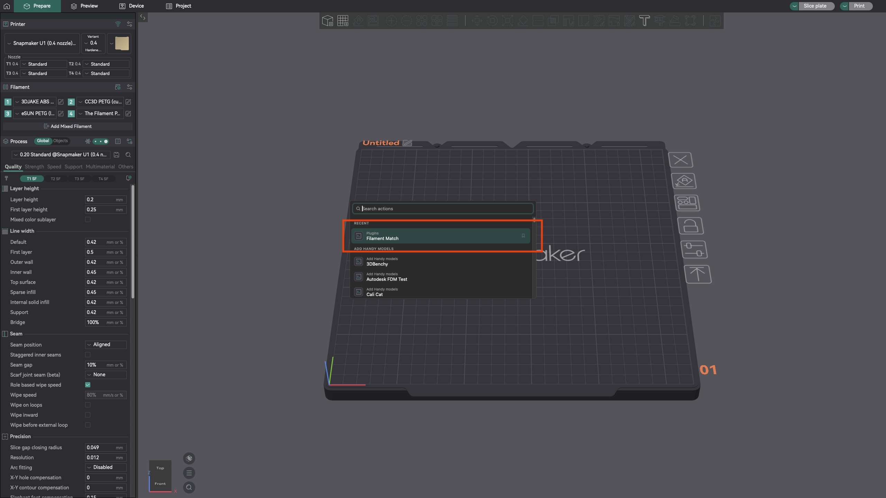
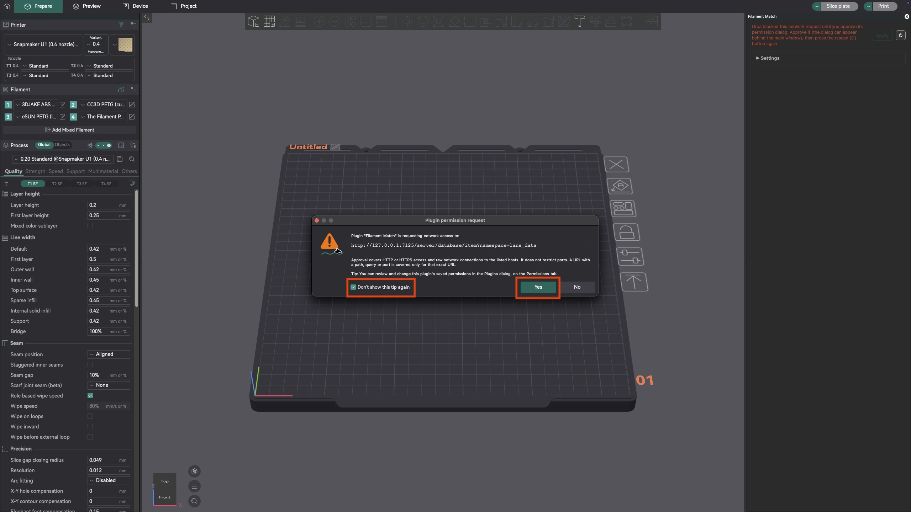
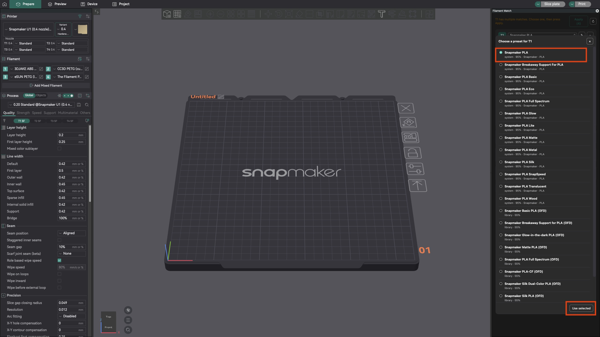
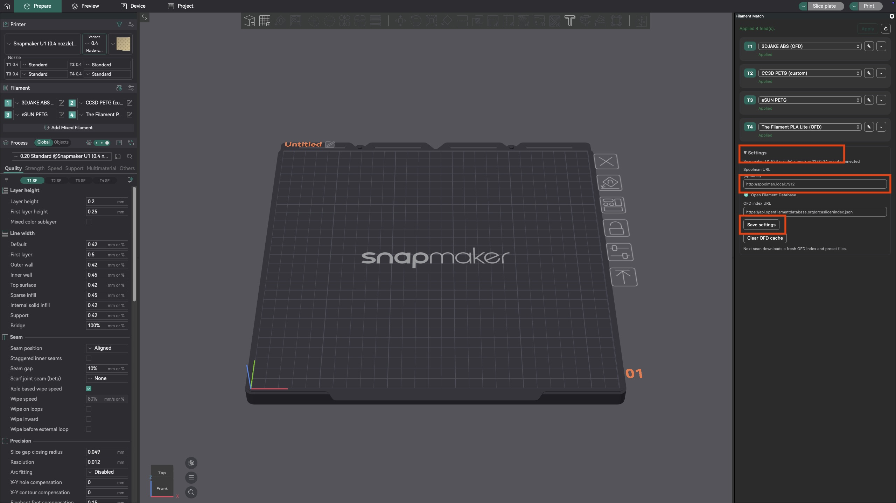
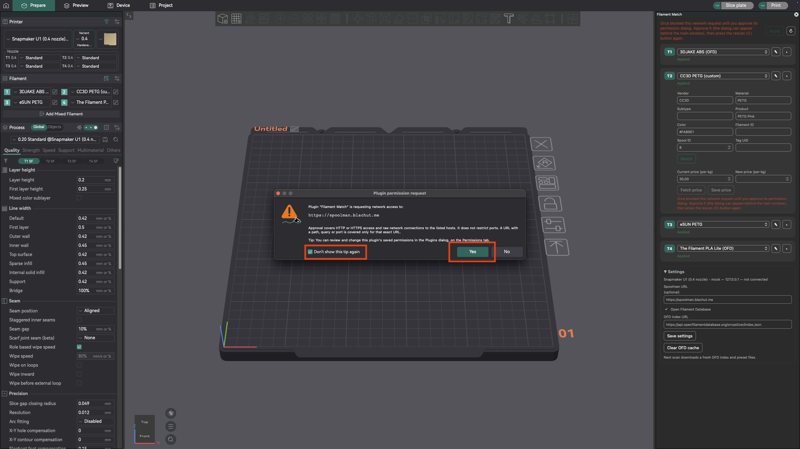

# Filament Match

Filament Match is an OrcaSlicer plugin that reads the filament loaded in each
printer slot, finds the best matching Orca filament preset, lets you review and
change the match, and applies the result to your project. Spoolman and the Open
Filament Database are optional enrichments, not requirements.

It is a **matcher and review layer**, not a preset generator. It works with the
presets already installed in Orca and remembers the spool, tag and filament
mappings you confirm.


## Features

- Reads filament data directly from the connected Moonraker or Snapmaker
  printer. There is no printer IP field to configure; the address comes from
  Orca.
- Matches every feed to a compatible installed Orca filament preset and shows
  why it matched.
- Scans automatically when the panel opens, but only **selects** candidates.
  Nothing is written to Orca until you press **Apply**.
- Lets you edit the detected vendor, material, subtype, product and colour,
  then rerun matching with **Match**.
- Opens a chooser when more than one preset is a viable match.
- Optionally enriches printer data from Spoolman by spool ID, including vendor,
  product, material, colour, temperatures and subtype.
- Fetches per-kg filament prices from Spoolman and writes them back to Orca
  presets. Manual price entry works without Spoolman.
- Uses the Open Filament Database (OFD) to propose presets for filaments that
  are not installed, with a local index cache for offline matching.
- Handles printer/project slot-count mismatches without silently changing the
  project or producing an error per extra feed.
- Remembers confirmed spool/tag/filament mappings across restarts and plugin
  reinstalls.
- Pure Python, no third-party packages, works on macOS, Windows and Linux.

## How to install

### Use the Orca Plugin Hub

1. In OrcaSlicer, sign in to Orca Cloud with the same account you use at
   [cloud.orcaslicer.com](https://cloud.orcaslicer.com).
2. Open **File → Plugins**, select the **Plugin Hub** tab, and search for
   **Filament Match**.
3. Click **Subscribe**, then enable **Activate** for the plugin.
4. Restart OrcaSlicer if the plugin does not appear immediately. You can then
   run it from **File → Plugins → Filament Match → Run plugin**, from the Speed
   Dial, or with the Speed Dial shortcut.

Orca Cloud plugins are a beta feature. Use a current OrcaSlicer build with
plugin support; `2.5.2` is the tested version.

### Install from source

macOS and Linux:

```sh
git clone git@github.com:Brotholomew/filament-match.git
cd filament-match
./plugin/install.sh
```

On Linux, point the installer at your Orca data directory if it is not the
default:

```sh
./plugin/install.sh "$HOME/.config/OrcaSlicer"
```

Windows (PowerShell):

```powershell
git clone git@github.com:Brotholomew/filament-match.git
cd filament-match
python plugin\build_single_file.py
$dest = "$env:APPDATA\OrcaSlicer\orca_plugins\filament_match"
New-Item -ItemType Directory -Force -Path $dest | Out-Null
Copy-Item plugin\dist\filament_match.py "$dest\filament_match.py"
'{"enabled": true}' | Set-Content "$dest\.install_state.json"
```

Then restart OrcaSlicer, open **File → Plugins**, enable **Filament Match**, and
run it. The plugin opens as a docked panel beside the sidebar; drag it, float it,
or close it like Orca's own panels. On hosts without dock panels it opens a
normal window.

> [!IMPORTANT]
> Do not enable the local development copy and the Orca Cloud subscription at
> the same time. They use separate plugin folders and both would auto-load.
> Remove the local folder if you switch to the Hub version, or unsubscribe if
> you switch back.

For manual installation, uninstall steps and platform details, see
[plugin/INSTALL.md](plugin/INSTALL.md).

## Plugin usage

1. Make sure your printer is connected in Orca:

   

2. Press the space bar to open the Speed Dial, or navigate to
   **File → Plugins → Filament Match → Run plugin**:

   

3. Allow the plugin to start:

   

4. Allow the plugin to access your printer's lanes and filament detection:

   

   

5. Re-scan the printer after granting access:

   

6. You may have to approve the printer permission checks again:

   

   

   

7. The presets are matched to your printer's spools. Missing presets are
   fetched from the Open Filament Database. Review the rows and press **Apply**
   to write the selected presets to Orca:

   

8. You can edit the search metadata used to find presets for a feed:

   

9. If more than one preset matches the metadata, a list of matching presets
   appears. Choosing one changes the selection only; press **Apply** to use it:

   

10. Optionally, connect a Spoolman instance in the **Settings** tile:

    

11. Allow the plugin to fetch data from Spoolman:

    

12. You can now fetch price data from Spoolman for a feed:

    

### What Match and Apply do

- Scanning selects the best candidate in each row. It does not change Orca.
- The preset input shows the current selection. Choosing another entry changes
  the selection only.
- The pencil button opens that preset's settings in a popup. It does not edit
  the preset itself.
- The chevron expands the fields used for matching.
- **Match** reruns matching from the edited fields and changes the selection
  only. It deliberately ignores confirmed history.
- **Apply** writes every changed selection to Orca and remembers the confirmed
  spool, tag and filament mappings. If one row fails, the other rows are still
  applied and the failure is shown on that row.
- On the first scan, the best candidate is selected even when several are
  plausible; no popup opens. If **Match** produces more than one viable
  candidate, the chooser opens.
- A lone OFD candidate is preselected as **Library match**. Press **Apply** to
  install it.
- Use the small **↻** button at the top to scan again after changing the
  printer, spools or presets.

The plugin does not hook Orca's native **Sync filaments** button. It reads the
printer itself and leaves Orca's own button untouched.

## Filament prices

Expand a feed to see **Current price (per kg)**, **New price (per kg)**,
**Fetch price** and **Save price** after the Match button.

- **Current price** is the chosen preset's `filament_cost`.
- **Fetch price** reads the feed's Spoolman spool and converts the whole-spool
  price to Orca's per-kg price:
  `(spool.price ?? filament.price) / ((spool.initial_weight ?? filament.weight) / 1000)`.
- **Save price** stages the new price. **Apply** writes it into the preset.
- On the first scan, Spoolman prices are loaded into **New price**
  automatically. A rescan preserves a value you edited or fetched.
- Changing the chosen preset reloads **Current price** but leaves **New price**
  alone.
- If Spoolman is blank, invalid or unreachable, Fetch is disabled with a
  tooltip; manual new prices still work.

**Changes are applied only after you press `Save price` and then `Apply` at the
top of the plugin pane.** If you do not have a Spoolman instance, you can still
type a price into **New price** and save it the same way.

Orca's plugin API cannot save an existing preset. Plugin-owned local presets are
updated in place. A system preset gets a local copy named
`<preset base> (local)` that inherits the system preset. A **user preset** is
flattened into the copy and inherits its system parent, because Orca's local
bundle loader cannot resolve a user-preset parent and silently skips such a
copy. If multiple feeds share a preset, the last applied price wins.

The matcher ignores Orca's internal `_local/<bundle>/` prefix and the labels
`(local)`, `(custom)`, `(OFD)` and `(copy)`, so custom and local copies are
exact candidates. A `(local)` price copy ranks before its original. The price
fields are metadata only and do not participate in filament matching.

## Spoolman

Spoolman is optional enrichment by spool ID:

- the printer supplies slot data and often a spool ID;
- Spoolman fills vendor, product name, material, colour and temperatures when
  the printer does not;
- a Spoolman extra field (`orca_filament_preset` or `orca_preset`) can be used
  as an explicit preset hint;
- a Spoolman `variant` extra fills the subtype when the printer did not report
  one (for example `SnapSpeed`). A printer-reported subtype always wins.

Spoolman does not provide Orca's preset list, does not perform the matching and
is not needed for the plugin to work.

## Open Filament Database

If no installed preset is a good match, the plugin can propose an OFD preset.
The OFD index is cached locally and used without a network request, so vendor
presets still appear when Orca's network permission is denied. Applying an OFD
candidate uses a cached preset JSON when available and fetches one preset
otherwise.

The **Settings** tile has **Clear OFD cache**. It deletes only the local OFD
index (`ofd_index.json`) and cached preset JSON (`ofd_presets/`); history,
settings and installed presets are kept. The next **↻** downloads a fresh index.

## Matching order

1. A user-confirmed mapping for the exact spool/tag/filament identity, but only
   if the mapped preset still fits the current vendor/material/subtype/product
   (and colour when the preset has one). A stale refill mapping falls through.
2. Exact printer-reported Orca `filament_id` among compatible installed presets.
3. Exact vendor + material + subtype + product. Product text that is only a
   colour (`Yellow`), only the vendor/material (`PETG Pink`), or the material
   plus a grade word (`PETG Basic`, `Premium PCTG`) does not count as a product
   constraint. Meaningful names such as `ABS Pastel` or `PETG Matte` still do.
4. A fuzzy name/colour match above a confidence threshold. Vendor presets that
   carry the variant only in their name (for example `Snapmaker PLA SnapSpeed`)
   are compared by name tokens when the preset has no explicit subtype setting.
5. An optional Open Filament Database candidate.
6. The exact compatible `Generic <material>` preset, not a variant such as
   `Generic PLA-CF`, unless no exact generic material preset exists.

History is stored in Orca's per-plugin data folder and survives restarts and
plugin reinstalls:

```text
macOS:   ~/Library/Application Support/OrcaSlicer/orca_plugins/plugin_data/filament_match/history.json
Linux:   ~/.config/OrcaSlicer/orca_plugins/plugin_data/filament_match/history.json
Windows: %APPDATA%\OrcaSlicer\orca_plugins\plugin_data\filament_match\history.json
```

Only user-confirmed matches are recorded; automatic generic fallbacks are not.

## Slot count mismatch

OrcaSlicer 2.5.2 has no plugin API to add, remove or resize project filament
slots, so the plugin never silently changes Orca's slot count:

- if the printer reports more feeds than the project has slots, the extra feeds
  are shown as **No Orca slot** and skipped by **Apply**; the panel shows exactly
  how many slots to add;
- if the project has more slots than the printer reports, the extra project
  slots are left untouched; the panel shows how many to remove.

Add or remove the stated number of filaments in Orca's **Filament** tab, then
press **↻**. The plugin applies every feed that has a slot.

## Limitations

- OrcaSlicer's plugin API cannot add a button next to the native **Synchronize
  filament list from AMS** button. The plugin opens a docked panel instead;
  adding that exact button needs a C++ change to OrcaSlicer.
- The plugin cannot override Orca's native AMS/filament sync. There is no
  sync-complete event or tray-payload plugin API.
- The plugin cannot open Orca's native Filament Settings dialog. The pencil
  button shows the preset's settings in the plugin's own popup; edit the preset
  itself in Orca.
- `begin_update` is shipped but undocumented; applying a match reports failures
  instead of silently ignoring them.
- System presets are often served from `.opc` caches, so the plugin does not
  rely on reading their JSON or on their `filament_id`.
- Generic Moonraker reports material/colour/filament ID, not vendor/subtype.
  Those fields stay blank unless Spoolman or a richer printer API supplies them.
- Do not run another plugin that also changes filament slots at the same time.

## Troubleshooting

**The plugin does not appear.** Restart Orca, open **File → Plugins**, and check
that **Filament Match** is enabled. If you installed from source, confirm that
the plugin folder contains exactly one direct `.py` file:

```text
orca_plugins/filament_match/filament_match.py
```

**A network request was denied.** Orca asks once per base origin: the printer
address, the Spoolman address and the OFD. Approve the prompt and press **↻**.
The in-flight request may fail while the dialog is open.

**An old version keeps loading.** Older source installs sometimes left a folder
named `orca_plugins/filament_match.py/`. Orca loads that folder instead of
`orca_plugins/filament_match/`. Remove the legacy folder:

```sh
rm -rf "$HOME/Library/Application Support/OrcaSlicer/orca_plugins/filament_match.py"
```

Current versions of `plugin/install.sh` remove it automatically. Orca must be
restarted after changing plugin files.

**A price copy does not appear.** Make sure Orca is restarted after installing
the plugin. A price copy of a user preset must inherit a system parent; older
copies that inherited a user preset were skipped by Orca's local bundle loader.
Re-apply the price with the current version to regenerate the copy.

## Development

```text
plugin/
  filament_match.py          # Orca entry point, action and UI
  filament_match_core.py     # pure matching and history logic
  filament_match_sources.py  # printer, Spoolman and OFD adapters
  tests/                     # unittest suites
  dev/mock_printer.py        # editable mock Snapmaker/Moonraker printer
  build_single_file.py       # flatten to one installable .py
  build_hub_file.py          # generate the Orca Cloud upload artifact
  install.sh                 # build and install locally
  PLAN.md                    # design and phases
  API_NOTES.md               # verified Orca 2.5.2 plugin API notes
  TESTING.md                 # live test checklist
  MOCK_PRINTER.md            # mock printer setup and editor
```

Build the single-file plugin:

```sh
python3 plugin/build_single_file.py
```

Build the Orca Cloud artifact:

```sh
python3 plugin/build_hub_file.py
# or, for a release version:
python3 plugin/build_hub_file.py --version 0.8.0
```

The Hub artifact is written to `plugin/hub/filament_match_any.py`. The `_any`
suffix tells Orca Cloud the plugin is pure Python and runs on every supported
operating system.

Run the tests:

```sh
python3 plugin/build_single_file.py
python3 -m unittest discover -s plugin/tests -p 'test_*.py' -v
```

To test feeder counts and filament combinations without a real printer, see
[plugin/MOCK_PRINTER.md](plugin/MOCK_PRINTER.md).

## Publishing

Every GitHub release publishes a new Orca Cloud version through OIDC trusted
publishing. No repository tokens or secrets are stored in the workflow.

- Workflow: [`.github/workflows/publish-orcacloud.yml`](.github/workflows/publish-orcacloud.yml)
- Artifact: `plugin/hub/filament_match_any.py`
- Trigger: a published GitHub release
- Version: the release tag without the leading `v`
- Changelog: the GitHub release notes, truncated to Orca Cloud's limit

The release tag must be a semantic version higher than the currently published
plugin version. The workflow builds the artifact with the tag version before
uploading, so the file header and `PLUGIN_VERSION` always match the release.

See [plugin/HUB_PUBLISHING.md](plugin/HUB_PUBLISHING.md) for the Hub listing
fields and the GitHub publishing setup.
